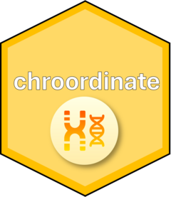

<!-- README.md is generated from README.Rmd. Please edit that file -->

```{r, include = FALSE}
knitr::opts_chunk$set(
  collapse = TRUE,
  comment = "#>",
  fig.path = "man/figures/README-",
  out.width = "100%"
)
```

# chroordinate <a href="https://joe-m-shaw.github.io/chroordinate/"></a>

<!-- badges: start -->
[](https://app.codecov.io/gh/joe-m-shaw/chroordinate)
<!-- badges: end -->

chroordinate allows you to coordinate chromosome coordinates during data analysis.

## Installation

You can install the development version of chroordinate from [GitHub](https://github.com/) with:

``` r
# install.packages("pak")
pak::pak("joe-m-shaw/chroordinate")
```

## Naming convention

In `chroordinate` chromosomes are referred to as "chromosome" for clarity, instead
of "chr" (which can be mistaken for meaning "character") or "chrom".
For the second coordinate in a location, `chroordinate` uses "end" not "stop".

## Logo

The `chroordinate` logo uses an icon from FlatIcon made by [Magnific](https://www.flaticon.com/free-icon/genetics_5685648?term=chromosome&related_id=5685648).
