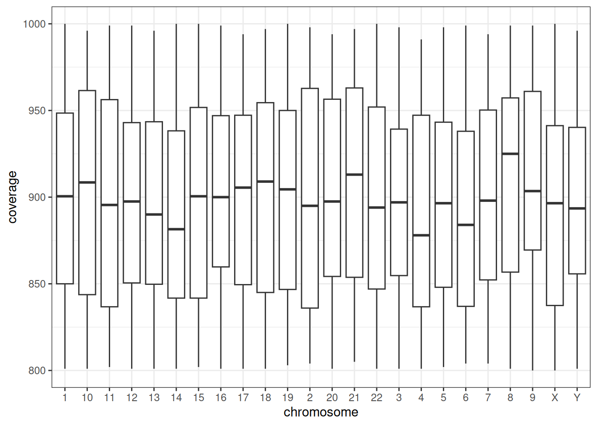
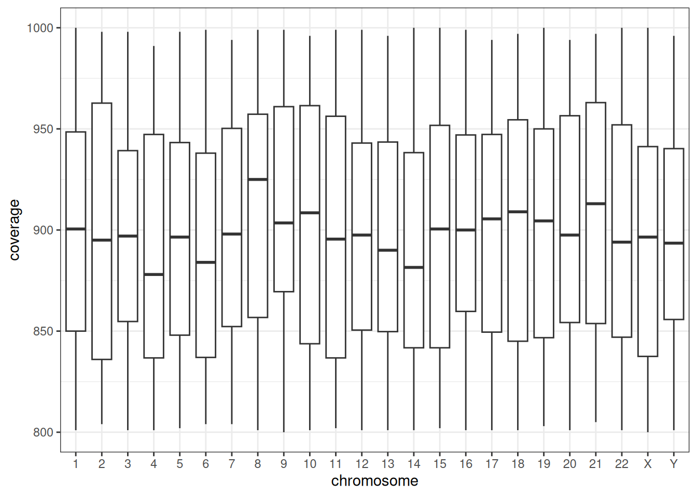

# Working with chromosomes in R

``` r

library(chroordinate)
library(readr)
library(readxl)
library(dplyr)
library(ggplot2)
```

Chromosome names can be difficult to work with for the following
reasons:

1.  They are a mixture of numbers (1-22) and letters (X and Y). This can
    make automatic assigning of data types difficult.

2.  They are ordered - it is traditional to present chromosomes in the
    order 1-22 followed by the X and Y chromosomes.

3.  They can be inconsistently formatted. For example the “chromosome”
    column of a table may contain information written as “1”, 1, “chr1”,
    “1p” etc.

`chroordinate` is designed to assist with some of these issues.

## Reading chromosomes from Excel files

Here is an example of a small Excel file containing a column of
chromosome information for autosomes 1-6. We can read it into R using
`read_excel`.

``` r


chr_excel_short_autosomes <- read_excel(path = "data/chr_short_autosomes.xlsx",
                              col_types = "guess")

knitr::kable(chr_excel_short_autosomes)
```

| chromosome |
|-----------:|
|          1 |
|          2 |
|          3 |
|          4 |
|          5 |
|          6 |

As col_types is set to “guess”, `read_excel` notes that there are only
numbers in the “chromosome” column and so assigns the “numeric” data
type.

``` r


typeof(chr_excel_short_autosomes$chromosome)
#> [1] "double"

unique(chr_excel_short_autosomes$chromosome)
#> [1] 1 2 3 4 5 6
```

If the Excel file also contains information on the X and Y chromosomes,
then `read_excel` notes that there are both numbers (autosomes) and
letters (sex chromosomes) in the column and so chooses type “character”.

``` r


chr_excel_short_all <- read_excel(path = "data/chr_short_all.xlsx",
                              col_types = "guess")

knitr::kable(chr_excel_short_all)
```

| chromosome |
|:-----------|
| 1          |
| 2          |
| 3          |
| 4          |
| 5          |
| 6          |
| X          |
| Y          |

``` r


typeof(chr_excel_short_all$chromosome)
#> [1] "character"

unique(chr_excel_short_all$chromosome)
#> [1] "1" "2" "3" "4" "5" "6" "X" "Y"
```

This behaviour then changes if the Excel is very long, which is common
for large genetic datasets from next generation sequencing. In this
examples, autosomes are listed first in the Excel and rows for sex
chromosomes only appear after ~2000 rows. This is a problem, because the
“guess” argument checks only the first 1000 rows, and decides that
“chromosome” will be data type numeric. The sex chromosomes are then
converted into NA, with warnings given (suppressed in this vignette).

``` r

chr_excel_long_guess <- read_excel(path = "data/chr_long.xlsx",
                              col_types = "guess")

typeof(chr_excel_long_guess$chromosome)
#> [1] "double"

unique(chr_excel_long_guess$chromosome)
#>  [1]  1  2  3  4  5  6  7  8  9 10 11 12 13 14 15 16 17 18 19 20 21 22 NA
```

One option is to specify that the chromosome column is type “text” when
reading the file in.

``` r


chr_excel_long_text <- read_excel(path = "data/chr_long.xlsx",
                              col_types = c("text", "numeric", "numeric"))

typeof(chr_excel_long_text$chromosome)
#> [1] "character"

unique(chr_excel_long_text$chromosome)
#>  [1] "1"  "2"  "3"  "4"  "5"  "6"  "7"  "8"  "9"  "10" "11" "12" "13" "14" "15"
#> [16] "16" "17" "18" "19" "20" "21" "22" "X"  "Y"
```

This solves the problem of the missing sex chromosomes. But it
introduces a new problem that the chromosomes are not ordered correctly
when plotted: chromosome 10 is ordered after chromosome 1.

``` r


ggplot(chr_excel_long_text, aes(x = chromosome, y = coverage)) +
  geom_boxplot() +
  theme_bw()
```



`chroordinate` can be used to solve this issue by specifying the
col_type as “text” and then converting the chromosome column into a
factor using `factorise_chromosome`.

``` r


chr_excel_long_factor <- read_excel(path = "data/chr_long.xlsx",
                              col_types = c("text", "numeric", "numeric")) |> 
  mutate(chromosome = factorise_chromosome(chromosome))

typeof(chr_excel_long_factor$chromosome)
#> [1] "integer"

str(chr_excel_long_factor$chromosome)
#>  Factor w/ 24 levels "1","2","3","4",..: 1 1 1 1 1 1 1 1 1 1 ...
```

This means that the chromosomes are in the correct ordered when plotted.

``` r


ggplot(chr_excel_long_factor, aes(x = chromosome, y = coverage)) +
  geom_boxplot() +
  theme_bw()
```



### Chromosome formatting in pipeline-generated Excel files

Reading chromosome information from an Excel file can be more
complicated if the Excel file has been generated by a bioinformatics
pipeline.

Here is an example from the PanSolid next generation sequencing
pipeline. The file contains a variant on chromosome 4, which is
specified in cell A2 of the Excel file (I have not included the file for
information governance reasons). In one version of the Excel output (the
“Annotated” output) the A2 cell is formatted as a number. This can be
seen by opening the underlying .xml:

``` xml
<c r="A2">
<v>4</v>
```

When `read_excel` is used to read in the file, the chromosome is
formatted as 4.

However, in the other version of the Excel output (the “Unannotated”
output), cell A2 is formatted as a floating point number with a decimal
point (see below). But when the cell is viewed in Excel, it still
appears as 4 because Excel doesn’t display the decimal point by default.

``` xml
<c r="A2" s="2" t="n">
<v>4.0</v>
```

This means that using `read_excel` with col_types = “text” on these two
files will give different chromosome results:

| Value.from.Annotated.file | Value.from.Unannotated.file |
|:--------------------------|:----------------------------|
| 4                         | 4.0                         |

## Reading chromosomes from CSV files

Unlike `readxl`, the `guess_max` argument in `read_csv` checks 1000 rows
spread throughout the file, not just the first 1000 rows. This means
that sex chromosomes are not converted into NAs, even if the file is
long and col_types are guessed.

``` r


chr_csv_long <- read_csv(file = "data/chr_long.csv",
                         col_types = "?")

typeof(chr_csv_long$chromosome)
#> [1] "character"

unique(chr_csv_long$chromosome)
#>  [1] "1"  "2"  "3"  "4"  "5"  "6"  "7"  "8"  "9"  "10" "11" "12" "13" "14" "15"
#> [16] "16" "17" "18" "19" "20" "21" "22" "X"  "Y"
```

However this still leaves the issue of chromosome ordering, which can be
solved by supplying the correct order as `levels_chromosomes` within the
col_types argument.

``` r


chr_csv_long_factor <- read_csv(file = "data/chr_long.csv",
                         col_types = list(
                           "chromosome" = col_factor(levels = levels_chromosomes()$all)
                         ))

ggplot(chr_csv_long_factor, aes(x = chromosome, y = coverage)) +
  geom_boxplot() +
  theme_bw()
```


